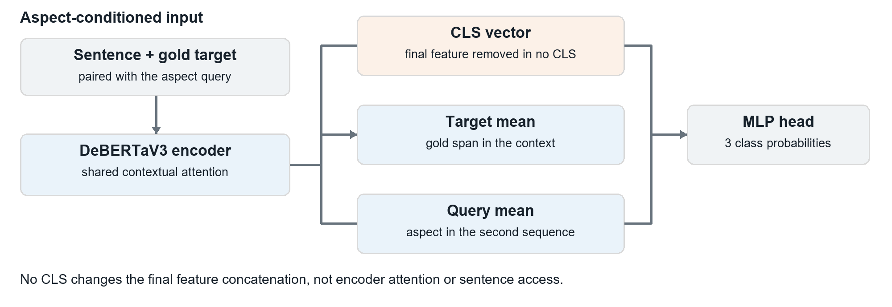
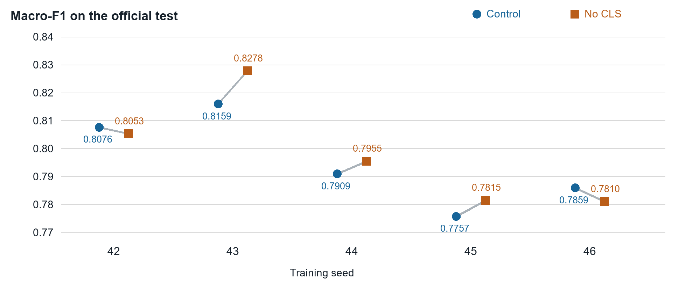
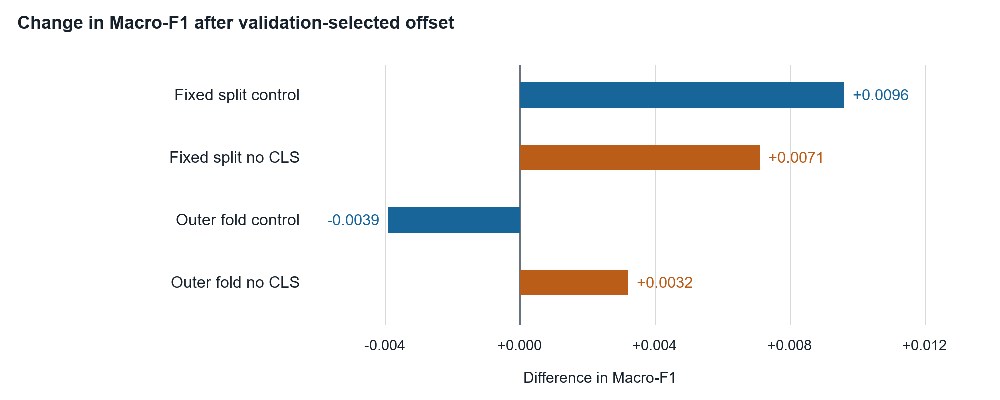

# Diagnosing Neutral Sentiment in Aspect Based Sentiment Analysis

Model Ablations and Evaluation Robustness

COMP4136 Natural Language Processing · Group 9 · Review copy · 17 November 2026

Zhang Xuanrui 23270128 · Zhao Yuzhou 23270772 · Hua Chunyang 23259906

## Abstract

Neutral aspect sentiment is difficult to recover even when overall accuracy is high. We study three-class sentiment classification for gold aspect terms in SemEval-2014 restaurant reviews, comparing a BERT baseline with DeBERTa pair models and examining representation, context scope and decision rules. Across five training seeds on a fixed partition, the DeBERTa control achieves 0.7952 ± 0.0164 Macro-F1 but only 0.5944 ± 0.0438 neutral F1. Removing the final CLS feature changes mean Macro-F1 by +0.0030, with inconsistent per-seed effects. A validation-selected neutral offset raises mean neutral F1 to approximately 0.621 for both variants on the official test set, but its benefit changes under three-fold evaluation with inner validation. Neutral average precision remains well above prevalence, contradicting the claim that the model has no useful ranking signal. Scope diagnostics suggest sensitivity to neighboring opinions, although the synthetic pairs still require human review. A code audit also identifies an inconsistency in the historical ordinal head, which we exclude from conclusions about ordinal methods. Our contribution is a reproducible diagnostic framework and a qualified account of when apparent neutral-class improvements hold.

## 1 Introduction

A restaurant review can praise food, criticize service and merely mention the menu in the same sentence. Sentence sentiment cannot describe all three targets. Aspect-based sentiment analysis (ABSA) associates an opinion with a particular aspect; our classification task assumes the aspect span is already known [1]. Removing neutral would force an unevaluated mention into a positive or negative category and change the benchmark task.

We retain all three labels and investigate three explanations for low neutral recall: an unsuitable representation, interference from unrelated opinions, or a decision rule that suppresses neutral. We compare repeated runs and evaluation protocols before interpreting a small gain as an improvement. The study combines an implemented classifier, diagnostic interventions and an audit of experimental claims.

Evidence status. Model scores are transcribed from the group’s committed results at repository snapshot 9274787. This revision independently checks code, dataset records and arithmetic; it does not rerun those training experiments. Complete checkpoints, prediction files and training histories were absent from the tracked snapshot. Model intervals and individual model errors therefore cannot be independently reconstructed here.

<!-- PAGEBREAK -->

## 2 Background Survey and Research Questions

### 2 1 Aspect sentiment and neutral annotation

SemEval-2014 separates aspect extraction from aspect sentiment classification and permits positive, negative, neutral and conflict annotations [1]. Neutral denotes an aspect without an expressed positive or negative opinion. Conflict denotes both polarities and should not be silently relabeled as neutral. Our processed Restaurant3 corpus excludes conflict targets and evaluates three classes, a narrower task than the original four-label evaluation.

Neutral concerns a target in context, not the absence of sentiment anywhere in the sentence. An opinion about atmosphere does not automatically apply to drinks mentioned nearby. Some gold annotations also require contextual interpretation, so lexical rules such as “contains a positive word” are insufficient. We evaluate against the benchmark labels rather than replacing difficult examples after inspecting predictions.

### 2 2 Models and competing explanations

BERT established pretraining followed by supervised fine-tuning as a general approach to language understanding [2]. Sun et al. reformulated ABSA using auxiliary sentence pairs [3]. Our implementation follows the aspect-conditioning idea but uses the bare aspect term as the second sequence; it does not reproduce their full QA or NLI formulations. DeBERTaV3 uses replaced token detection and gradient disentangled embedding sharing [4]. We compare the repository’s systems under their recorded settings rather than attributing every difference solely to the encoder.

Scope-oriented ABSA research addresses interference from opinions about other aspects [5]. This motivates our context and counterfactual diagnostics, without establishing a cause for every neutral error. Ordinal regression offers another hypothesis: the three labels might be represented through ordered decisions. CORAL uses a specific rank-consistent architecture [6]; our historical ordinal code does not reproduce it and has an additional objective mismatch.

Probability calibration asks whether stated confidence agrees with correctness frequencies [7]. Multiplying neutral scores to maximize validation Macro-F1 instead changes an operating point; improved F1 alone does not demonstrate calibration. Class-prior adjustment is related mathematically [8], but we neither establish label shift nor reproduce its EM procedure. Selection over finite validation data also introduces variance [9]. Recent instruction-based work, including PFInstruct [10], suggests other approaches, although its extraction and opinion-pair metrics cannot be compared directly with gold-target classification.

### 2 3 Research questions

RQ1 asks whether removing the final CLS feature gives a repeatable gain. RQ2 asks whether neutral scores contain useful ranking information and whether an offset generalizes across partitions. RQ3 asks whether subgroup and controlled-pair results support scope interference. We keep these questions distinct and report unstable results alongside favorable ones. Selection variability can itself distort model comparisons [9], making the evaluation protocol part of the scientific question.

<!-- PAGEBREAK -->

## 3 Data and Task Definition

### 3 1 Corpus construction

We use the repository’s processed SemEval-2014 Restaurant3 XML files. The training source contains 3,041 sentence records and 3,602 retained aspect targets; the official test contains 800 records and 1,120 targets. The conversion manifest records exclusion of 91 training and 14 test conflict aspect terms. Another 195 excluded training aspect categories belong to a different annotation layer and must not be added to the aspect-term count. Source revisions and file hashes are retained in the manifest.

For the fixed experiment, exact sentence text defines training and validation grouping, with split seed 42. Training-pool records whose text occurs in the official test are removed before fitting. Eligible-target sentence counts are 1,682 training and 295 validation records. The 1,682 training records contain 1,680 distinct texts; record and unique-text counts differ. Background sentences without eligible targets may remain in the joint model’s extraction data, but do not become sentiment-classification examples.

Table 1. Fixed-split label distribution. Counts refer to aspect targets, not sentences.

| Split | Negative | Neutral | Positive | Total |
|---|---:|---:|---:|---:|
| Training | 677 | 520 | 1849 | 3046 |
| Validation | 128 | 113 | 314 | 555 |
| Official test | 196 | 196 | 728 | 1120 |

Positive targets account for 65.0% of the official test, whereas neutral accounts for 17.5%. An always-positive classifier attains 0.650 accuracy while never recovering a neutral target. Accuracy can therefore conceal the failure under study. Macro-F1 gives each class equal weight, and neutral precision and recall distinguish conservative prediction from broad recovery.

### 3 2 Prediction unit and annotation rule

The prediction unit is a sentence together with one gold aspect span. Three targets in a sentence yield three classifications, potentially with different labels. The principal task does not measure aspect extraction; a gold-target sentiment score must not be presented as end-to-end extraction performance.

Our operational rule is to label the attitude toward the specified target, retain neutral for a mention without expressed polarity, and keep conflict outside this three-class evaluation. For human-created diagnostic pairs, reviewers must also confirm that the edited neighboring opinion leaves the target sentiment unchanged. All 40 candidate pairs remain pending review, limiting their evidential role.

<!-- PAGEBREAK -->

## 4 Methodology and Implementation

### 4 1 Aspect conditioned pair model

The baseline encodes a sentence and aspect query with BERT. The enhanced pair model uses DeBERTaV3-base and retains the gold span during context cropping. Its classifier concatenates the contextual CLS vector, the mean of target-span token vectors and the mean of aspect-query token vectors. Layer normalization, dropout, a 256-unit GELU layer and an output head produce sentiment scores. No CLS removes only the final CLS feature from this concatenation. CLS remains in the encoder input, and target vectors still attend to sentence context; the intervention does not remove global information.

Figure 1. Original schematic of PairABSA. The final CLS feature is optional; the encoder and contextual target and query representations remain shared.

### 4 2 Heads and context interventions

The control uses a three-way softmax. A gate alternative predicts opinion presence and, conditional on presence, negative versus positive polarity. Neutral probability is one minus presence probability. A clause variant uses a heuristic target-clause crop. These alternatives have one recorded seed and remain exploratory.

The historical ordinal head trains two unconditional cumulative targets but multiplies their probabilities at inference as though the second were conditional. For cumulative probabilities 0.8 and 0.6, its positive probability becomes 0.48 rather than 0.6. Its result cannot test a consistent ordinal model or CORAL [6]. We preserve checkpoint behavior and add a separately named ordered head with monotone cumulative probabilities and a matching loss. The new head has software checks but no trained benchmark result and is excluded from performance tables.

### 4 3 Neutral decision offset

For a positive scalar k, we multiply the neutral probability by k and renormalize before argmax. Equivalently, we add log k to the neutral logit. Larger k favors neutral without retraining. Validation Macro-F1 selects k; held-out data evaluate the chosen rule. We call this decision-rule tuning rather than demonstrated probability calibration.

<!-- PAGEBREAK -->

## 5 Experimental Protocol and Reproducibility

### 5 1 Recorded training settings

Table 2. Recorded system settings. Unmatched settings limit encoder-level causal claims.

| Setting | BERT baseline | DeBERTa pair |
|---|---|---|
| Training seeds | 42 to 46 | 42 to 46 |
| Fixed split seed | 42 | 42 |
| Maximum tokens | 128 | 192 |
| Maximum epochs | 3 | 6 |
| Batch size | 4 | 2 with accumulation 4 |
| Learning rates | 0.00002 | Encoder 0.00001 and head 0.0001 |
| Checkpoint criterion | Validation Macro-F1 | Validation gold-target accuracy |

Control and no CLS use matched settings and seed IDs. BERT versus DeBERTa compares complete systems; different budgets and checkpoint criteria prevent an isolated encoder comparison. The group records an RTX 5060 Laptop GPU with 8 GB memory, BF16 and roughly 18 minutes per DeBERTa run. These runtime observations were not independently remeasured.

### 5 2 Metrics and uncertainty

We report accuracy, Macro-F1 and neutral precision, recall and F1. Macro-F1 averages the three class F1 scores, with each class F1 the harmonic mean of its precision and recall. Positive and negative P and R were not retained in the committed summary; a complete per-class table requires the raw outputs. Mean ± SD denotes sample variation across training seeds, not a confidence interval. Average precision evaluates the one-versus-rest ranking of neutral probabilities. Multiclass argmax is not a probability threshold of 0.5. A neutral logit offset thresholds a margin against the strongest alternative and need not preserve the neutral-probability ranking.

Targets within a sentence are dependent. New interval calculations resample exact-text sentence clusters, retaining every target in a selected sentence and pairing the same resample across rules. These intervals condition on fitted models and do not capture all training or selection uncertainty. Historical offset intervals used aspect-row resampling; we do not relabel them as sentence-cluster intervals. Corrected intervals require the missing raw predictions.

### 5 3 Evaluation across partitions

The fixed split varies training seed with a constant data partition. The offset grid is 1, 1.25, 1.5, 2, 2.5, 3, 4, 5 and 6. In three-fold evaluation, each outer training partition has an inner validation split for checkpoint and offset selection; the selected procedure predicts the outer held-out partition. The official test is excluded from this pool of 3,040 sentence records and 3,601 targets after overlap removal.

This is outer cross-validation with inner holdout selection, not a fully nested search over every architecture and hyperparameter. Folds share training data, and exact-text grouping does not establish original-review independence. Because the official test was inspected during development, comparisons are exploratory rather than a pristine final confirmation [9]. The committed source, curated values and audit notes document these limits; full run artifacts remain needed for computational reproduction.

<!-- PAGEBREAK -->

## 6 Quantitative Results

### 6 1 Repeated system comparison

Table 3. Official-test results from committed group records. Five seeds per row; means ± sample SD. Neutral P and R are averages of per-run metrics.

| System | Accuracy | Macro F1 | Neutral P | Neutral R | Neutral F1 |
|---|---:|---:|---:|---:|---:|
| BERT pair | .8398 ± .0099 | .7535 ± .0292 | .737 ± .081 | .469 ± .112 | .562 ± .072 |
| DeBERTa control | .8727 ± .0076 | .7952 ± .0164 | .771 ± .028 | .486 ± .055 | .5944 ± .0438 |
| DeBERTa no CLS | .8738 ± .0101 | .7982 ± .0194 | .746 ± .047 | .508 ± .047 | .6034 ± .0401 |

The DeBERTa systems have higher mean accuracy and Macro-F1 under their recorded settings. Neutral recall remains around one half. No CLS shifts the balance toward higher recall and lower precision, with a mean neutral F1 gain near 0.009, smaller than the between-seed spread. BERT neutral F1 ranges from approximately 0.480 to 0.641, cautioning against conclusions based on one favorable run.

Figure 2. Recorded Macro-F1 for matched seeds on the fixed split. No CLS does not consistently outperform control. Values are transcribed, not newly rerun.

### 6 2 Effect of the CLS intervention

Paired Macro-F1 differences for seeds 42 to 46 are −0.0023, +0.0118, +0.0046, +0.0059 and −0.0049. The mean is +0.0030 with SD 0.0067, indicating a small, unstable observed effect. Lack of convincing improvement does not establish equivalence. The feature ablation also cannot identify where the encoder represents sentence polarity. No CLS has lower Macro-F1 in all three outer folds, with mean fold scores 0.7591 versus 0.7650 for control.

<!-- PAGEBREAK -->

## 7 Ranking and Decision Rules

### 7 1 Useful ranking and its limits

Mean neutral average precision is 0.7112 for control and 0.7198 for no CLS, compared with prevalence 0.175. There is useful ranking signal despite low recall at the deployed operating point. Describing neutral ranking as random or essentially absent is therefore inaccurate.

The highest F1 found by sweeping the neutral-probability threshold on test labels averages 0.6585 and 0.6665. These are optimistic diagnostic maxima for a specified score and threshold family, not a dataset ceiling or a bound on future models and logit-offset rules. Their use of test labels prevents deployment claims. A locally flat precision–recall segment also cannot establish that the representation cannot improve.

### 7 2 Offset benefit across protocols

Table 4. Recorded offset results. Fixed-split values are five-seed means; outer-fold values are pooled out-of-fold metrics, a different aggregation.

| Protocol and model | Macro F1 before | Macro F1 after | Neutral F1 before | Neutral F1 after |
|---|---:|---:|---:|---:|
| Fixed split control | .7952 | .8048 | .5944 | .6206 |
| Fixed split no CLS | .7982 | .8053 | .6034 | .6206 |
| Outer fold control | .7652 | .7613 | .5740 | .5739 |
| Outer fold no CLS | .7596 | .7628 | .5639 | .5767 |

Figure 3. Macro-F1 changes after validation-selected offsets. The control effect changes sign across protocols. Different training partitions and aggregation prevent a pure comparison of test-set difficulty.

Of ten fixed-split configuration–seed combinations, eight Macro-F1 changes are strictly positive and two are ties. The earlier “10 of 10 improvements” statement is incorrect. A sign test excludes ties [11]; pooling configurations that share seed IDs and a test set also does not establish ten independent units. We make no pooled significance claim. The observed gain is split-specific. Operating-point differences, sample composition and selection variability may contribute, but the records do not identify a unique cause.

<!-- PAGEBREAK -->

## 8 Scope Diagnostics and Exploratory Ablations

### 8 1 Neutral subgroups

For seed-42 control, recall is 0.458 for 83 neutral targets in sentences also containing a polar target, versus 0.584 for 113 neutral targets in pure-neutral sentences. Of 92 neutral errors, 41 match a neighboring target’s polar label: 44.6% of all neutral errors, or 91.1% of 45 errors eligible for that mixed-sentence comparison. This is not 45% of all test examples.

The pattern is consistent with scope interference, but label agreement is not causal evidence. Class frequency, complexity and annotation ambiguity may contribute. No CLS does not resolve the subgroup problem: its mixed-sentence neutral recall is 0.410 in this seed. High error confidence describes stated certainty, not the linguistic evidence that produced the prediction.

### 8 2 Controlled neighboring opinion edits

The repository has 30 candidate neutral-target pairs and 10 polar-target controls. Each pair edits a neighboring opinion while intending to preserve the target label. Every pair awaits human approval. We report the existing aggregate outputs as a pilot, without formal significance or model-selection claims.

Table 5. Seed-42 pilot on 30 unreviewed neutral pairs. Invariance means the predicted class is unchanged; both correct requires neutral in both sentences.

| Model | Invariant | Both correct | Mean absolute neutral probability change |
|---|---:|---:|---:|
| Control | .200 | .200 | .354 |
| No CLS | .433 | .433 | .257 |
| Clause crop | 1.000 | .867 | .000 |

No CLS reduces mean probability sensitivity by approximately 27%, not one half. Clause invariance can be mechanical when the edited text is deleted from the input; it is insufficient evidence of better understanding. Control is invariant and correct on all ten polar controls, but this small constructed sample does not establish general robustness.

### 8 3 Single seed alternatives

Gate records neutral F1 0.610 and Macro-F1 0.8018; clause crop records 0.523 and 0.7438. Seed-42 control records 0.632 and 0.8076. These are exploratory observations, not a repeated ranking. Clause failure may reflect useful context removal or segmentation errors. The legacy ordinal result is quarantined because of Section 4’s objective mismatch. These observations cannot establish that architectural changes are incapable of improving neutral classification.

<!-- PAGEBREAK -->

## 9 Case Study and Practical Application

### 9 1 Gold labelled corpus cases

These actual XML records were independently inspected in this revision. They illustrate annotation and target attribution; individual model outputs are unavailable, so they are not presented as reconstructed model successes or errors.

Case A. “A beautiful atmosphere, perfect for drinks and/or appetizers.” Gold labels are atmosphere positive, drinks neutral and appetizers neutral, in sentence 32899414#512291#0. Praise for the setting coexists with neutral labels for other mentions. A sentence-level positive label cannot substitute for aspect annotation. This also exposes an annotation challenge: suitability for an activity can sound favorable even where the benchmark does not label the items positively.

Case B. “Even when the chef is not in the house, the food and service are right on target.” Gold labels are chef neutral, food positive and service positive, in sentence 11359727#487554#2. The chef is a contextual condition; the explicit favorable assessment concerns food and service. Transferring praise to every noun would mislabel chef. This is a plausible failure to investigate, not a claim about the model’s output.

The cases explain what target-preserving annotation means, while the pilot pairs test sensitivity to neighboring edits. A complete qualitative error study requires saved predictions linked to IDs and spans, followed by review of successes and failures. Ambiguous cases should remain visible rather than being discarded because they weaken an explanation.

### 9 2 Restaurant feedback application

The repository implements train, evaluate and predict commands for aspect-conditioned classification. Given a sentence and user-specified aspect, an application can show the class and three scores. A dashboard could aggregate feedback about food, service and atmosphere while keeping neutral mentions separate from favorable and unfavorable opinions. The pair model assumes a supplied aspect; automatic discovery requires extraction and separate end-to-end evaluation.

Neutral and uncertainty are separate concepts. Neutral describes the opinion toward a target; uncertainty describes the reliability of a decision. A strong neutral score is not automatically uncertainty, and a confident positive prediction may still be wrong. Before deploying a benchmark-tuned offset, we would validate it on held-out reviews from the intended domain. Human review is a proposed interface feature, not an implemented performance result.

<!-- PAGEBREAK -->

## 10 Discussion and Conclusion

### 10 1 Answers and practical implications

For RQ1, no CLS has a small mean fixed-split gain with mixed seed-level signs and lower outer-fold scores; a reliable gain is not established. For RQ2, average precision shows meaningful ranking and the offset improves recorded official-test scores, but outer-fold behavior limits portability. For RQ3, subgroup and edit diagnostics motivate scope-aware modeling, while pending pair review and missing predictions prevent a causal conclusion.

The defensible goal is improved aspect attribution and reproducible evaluation, with neutral retained. Neither a target of 90% neutral F1 nor a universal ceiling near 0.63 follows from the evidence. A plausible inexpensive intervention can appear useful on one split and behave differently under another protocol. Reporting both is more informative than selecting the most favorable score.

### 10 2 Limits and next experiments

Only control and no CLS have five recorded seeds; other interventions remain single-seed observations. Five seeds are not a universal sufficiency threshold, and nonsignificance is not equivalence. The dataset is small, positive-heavy and confined to one domain and preprocessing choice. Exact-text grouping cannot guarantee original-review separation. Outer folds also have less training data, complicating score-level comparisons.

Next we would archive configurations, predictions and histories; complete blind pair review; and evaluate the corrected ordered head under matched settings. A useful scope intervention should improve reviewed counterfactual invariance and held-out classification, rather than achieve invariance by deleting context. Encoder comparisons should match budgets and checkpoint criteria. A final procedure should then be frozen before another held-out evaluation. These are planned experiments, not claimed results.

### 10 3 Reproducibility

This revision preserves the original result record and adds hashes, curated tables, arithmetic checks and figure-generation code. It corrects tie handling and makes future offset intervals use paired sentence-cluster sampling. Legacy ordinal behavior remains available for historical checkpoints; the corrected ordered head has a separate configuration name and no benchmark score. All figures are original project drawings. Missing run artifacts remain a barrier to full independent reproduction.

## Author Contributions

Group 9 comprises Zhang Xuanrui 23270128, Zhao Yuzhou 23270772 and Hua Chunyang 23259906. Individual responsibilities and contribution proportions await member confirmation and must be completed before submission. This review copy does not assign unverified work to an individual.

<!-- PAGEBREAK -->

## References

[1] M. Pontiki, D. Galanis, J. Pavlopoulos, H. Papageorgiou, I. Androutsopoulos, and S. Manandhar, “SemEval-2014 Task 4: Aspect Based Sentiment Analysis,” in Proc. SemEval, 2014, pp. 27–35, doi: 10.3115/v1/S14-2004. https://aclanthology.org/S14-2004/

[2] J. Devlin, M. W. Chang, K. Lee, and K. Toutanova, “BERT: Pre-training of Deep Bidirectional Transformers for Language Understanding,” in Proc. NAACL-HLT, 2019, pp. 4171–4186, doi: 10.18653/v1/N19-1423. https://aclanthology.org/N19-1423/

[3] C. Sun, L. Huang, and X. Qiu, “Utilizing BERT for Aspect-Based Sentiment Analysis via Constructing Auxiliary Sentence,” in Proc. NAACL-HLT, 2019, pp. 380–385, doi: 10.18653/v1/N19-1035. https://aclanthology.org/N19-1035/

[4] P. He, J. Gao, and W. Chen, “DeBERTaV3: Improving DeBERTa using ELECTRA-Style Pre-Training with Gradient-Disentangled Embedding Sharing,” in Proc. ICLR, 2023. https://openreview.net/pdf?id=sE7-XhLxHA

[5] H. Chai, Z. Yao, S. Tang, Y. Wang, L. Nie, B. Fang, and Q. Liao, “Aspect-to-Scope Oriented Multi-view Contrastive Learning for Aspect-based Sentiment Analysis,” in Findings of EMNLP, 2023, pp. 10902–10913, doi: 10.18653/v1/2023.findings-emnlp.727. https://aclanthology.org/2023.findings-emnlp.727/

[6] W. Cao, V. Mirjalili, and S. Raschka, “Rank consistent ordinal regression for neural networks with application to age estimation,” Pattern Recognit. Lett., vol. 140, pp. 325–331, 2020, doi: 10.1016/j.patrec.2020.11.008. https://arxiv.org/abs/1901.07884

[7] C. Guo, G. Pleiss, Y. Sun, and K. Q. Weinberger, “On Calibration of Modern Neural Networks,” in Proc. ICML, PMLR, vol. 70, 2017, pp. 1321–1330. https://proceedings.mlr.press/v70/guo17a.html

[8] M. Saerens, P. Latinne, and C. Decaestecker, “Adjusting the Outputs of a Classifier to New a Priori Probabilities: A Simple Procedure,” Neural Comput., vol. 14, no. 1, pp. 21–41, 2002, doi: 10.1162/089976602753284446.

[9] G. C. Cawley and N. L. C. Talbot, “On Over-fitting in Model Selection and Subsequent Selection Bias in Performance Evaluation,” J. Mach. Learn. Res., vol. 11, pp. 2079–2107, 2010. https://jmlr.org/papers/v11/cawley10a.html

[10] L. Cabello and U. Akujuobi, “It is Simple Sometimes: A Study On Improving Aspect-Based Sentiment Analysis Performance,” in Findings of ACL, 2024, pp. 6597–6610, doi: 10.18653/v1/2024.findings-acl.394. https://aclanthology.org/2024.findings-acl.394/

[11] National Institute of Standards and Technology, “Sign Test,” Dataplot Reference Manual. Accessed: Nov. 17, 2026. [Online]. Available: https://www.itl.nist.gov/div898/software/dataplot/refman1/auxillar/signtest.htm
